# Chapter 7: Migration Guidance

## 7.1 Intended Audience, Operational Scope, and Prerequisites

This chapter synthesizes the industrial motivation and problem statement of [Chapter 1: Introduction](../docs/chapter-01-introduction.md), the HotSpot runtime mechanics and literature foundations of [Chapter 2: Background and Related Work](../docs/chapter-02-background-and-related-work.md), the empirical systems methodology of [Chapter 3: Research Design and Methodology](../docs/chapter-03-research-design-and-methodology.md), the testbed and telemetry harness of [Chapter 4: Implementation and Research Infrastructure](../docs/chapter-04-implementation-and-research-infrastructure.md), the 119 benchmark executions of [Chapter 5: Experimental Results](../docs/chapter-05-experimental-results.md), and the queueing-theoretic derivations of [Chapter 6: Analysis and Answers to the Research Questions](../docs/chapter-06-analysis-and-answers-to-research-questions.md) into an evidence-bounded engineering migration framework. It provides software architects, principal engineers, and backend teams with actionable, correctness-preserving procedures for adopting Java 21 Virtual Threads within enterprise Spring Boot Model-View-Controller (MVC) systems.

To maintain strict epistemic integrity, every guideline, refactoring pattern, and diagnostic rule in this chapter is explicitly classified into one of four evidential categories, fully traceable to the ratified [Claim-to-Evidence Ledger](../docs/evidence-freeze/claim-evidence-ledger.md):
*   `[MEASURED]`: Grounded directly in empirical benchmark data from the 119 experimental executions conducted in this research.
*   `[EXTERNALLY SUPPORTED]`: Derived from published OpenJDK Enhancement Proposals (JEPs), vendor defect trackers, or established queueing and systems literature.
*   `[HEURISTIC / LITERATURE]`: Derived from established industry consensus, JVM engineering conventions, or literature benchmarks where specific micro-thresholds serve as operational heuristics.
*   `[THEORETICAL / CONDITIONAL]`: Rooted in analytical mathematical projections, worst-case derivations, or capacity models that require application-specific calibration.

### 7.1.1 Target System Characteristics
This guidance is specifically designed for enterprise systems possessing the following architectural characteristics:
1.  **Synchronous Servlet Architecture:** Applications built on Spring Boot 3.x and Apache Tomcat (or Eclipse Jetty / Undertow) utilizing synchronous HTTP request-response paradigms rather than reactive event loops (e.g., Spring WebFlux).
2.  **Relational Database Persistence:** Applications interacting with relational databases via standard JDBC interfaces, Spring's `JdbcTemplate`, or Spring Data JPA / Hibernate, managed by connection pools such as HikariCP (configured in [`application.yml`](../src/main/resources/application.yml)).
3.  **Heterogeneous Runtime Dependencies:** Codebases integrating third-party Java libraries, foreign function interfaces (JNI / Project Panama) such as [`native_blocking.c`](../native/native_blocking.c), or native cryptographic/driver packages.
4.  **High-Concurrency Workloads:** Services subject to concurrent traffic where thread pool exhaustion under platform threads historically limited system scalability.

### 7.1.2 Technical Prerequisites
Before initiating a virtual thread migration, engineering teams must establish three mandatory baseline prerequisites:
*   **JDK Runtime Baseline:** Deployment on OpenJDK 21 LTS or later. If monitor pinning elimination is desired without code refactoring, OpenJDK 24 (with JEP 491) is required `[EXTERNALLY SUPPORTED]`. If permanent standard Scoped Values (without preview flags) are required, OpenJDK 25 LTS (with JEP 506) is required `[EXTERNALLY SUPPORTED]`.
*   **Framework Baseline:** Spring Boot 3.2.0 or later (this study evaluated 3.5.12 in [`pom.xml`](../pom.xml)), ensuring native framework support for virtual thread dispatching via `spring.threads.virtual.enabled: true` in [`application.yml`](../src/main/resources/application.yml).
*   **Observability Baseline:** Production or staging infrastructure equipped to capture Java Flight Recorder (JFR) event streams, JVM Flight Recorder streaming APIs, and operating system thread/process metrics.

---

## 7.2 Pre-Migration Inventory and Triage Checklist

Enabling Virtual Threads in production without prior architectural auditing introduces severe operational failure modes, including silent carrier thread starvation, connection pool exhaustion, and memory bloat. Engineering teams must conduct a systematic four-phase inventory before modifying production runtime configurations.

```
+-----------------------------------------------------------------------------------+
|                         PRE-MIGRATION INVENTORY PIPELINE                          |
+-----------------------------------------------------------------------------------+
  Phase 1: Static Codebase Audit
  ├── Scan for 'synchronized' blocks wrapping I/O, network calls, or long delays
  ├── Inventory 'ThreadLocal' usage across services, filters, and interceptors
  └── Identify foreign function invocations (JNI 'System.loadLibrary', Panama FFM)
           │
           ▼
  Phase 2: Dependency Tree Resolution
  ├── Execute: mvn dependency:tree -Dverbose
  ├── Verify database drivers: pgjdbc >= 42.6.0, MySQL Connector/J >= 9.0.0
  └── Verify JSON / serialization libraries: jackson-databind >= 2.16.0
           │
           ▼
  Phase 3: Database & Connection Pool Audit
  ├── Audit connection checkout lifecycles relative to transaction boundaries
  ├── Calibrate pool sizing against database hardware and workload SLOs
  └── Establish workload-aligned connection acquisition timeouts
           │
           ▼
  Phase 4: Observability Infrastructure Setup
  ├── Configure continuous JFR recording with custom thresholds
  └── Implement Carrier Worker & Queue Latency Metrics (JMX/OS-level Telemetry)
```

### 7.2.1 Phase 1: Static Codebase Audit
1.  **Monitor Synchronization Scan:** Identify all occurrences of the `synchronized` keyword (both method-level and block-level). Triage each occurrence into:
    *   *Type A (Pure In-Memory Mutex):* Fast updates to shared in-memory collections ($< 10\text{ }\mu\text{s}$ as an ideal micro-hold; $10\text{--}50\text{ }\mu\text{s}$ is a transitional heuristic range). Safe on Java 21 when no blocking work is enclosed; unpinning usually offers little benefit `[HEURISTIC / LITERATURE]`.
    *   *Type B (Blocking Mutex):* Synchronization enclosing blocking socket I/O, database access, external HTTP calls, or sleep delays (demonstrated by [`PaymentService.java`](../src/main/java/com/thesis/virtualthreadsdemo/service/PaymentService.java)). **High Risk in the tested Java 21 construct:** it can trigger carrier pinning ([`CLM-RQ1-01`](../docs/evidence-freeze/claim-evidence-ledger.md#L42-L54)) `[MEASURED]`.
2.  **ThreadLocal Inventory:** Locate all static and instance references to `ThreadLocal` (such as in [`OrderService.java`](../src/main/java/com/thesis/virtualthreadsdemo/service/OrderService.java#L28)). Determine whether cleanup is guaranteed via `finally` blocks, and evaluate the memory footprint of retained context payloads ([`CLM-RQ2-07`](../docs/evidence-freeze/claim-evidence-ledger.md#L239-L253)) `[THEORETICAL / CONDITIONAL]`.
3.  **Foreign Function Audit:** Locate all native method declarations (`native`) and JNI bindings (`System.loadLibrary`) such as [`NativeBlockingService.java`](../src/main/java/com/thesis/virtualthreadsdemo/service/NativeBlockingService.java). Determine whether the underlying C/C++ implementations (e.g., [`native_blocking.c`](../native/native_blocking.c)) execute blocking system calls (`read`, `connect`, `nanosleep`, or POSIX mutex locks) that hold carrier threads captive ([`CLM-RQ2-01`](../docs/evidence-freeze/claim-evidence-ledger.md#L148-L161)) `[MEASURED]`.

### 7.2.2 Phase 2: Dependency Tree Resolution
Enterprise systems often inherit carrier-pinning vulnerabilities through transitive dependencies. Teams must execute:

```bash
mvn dependency:tree -Dverbose
```

Verify that all resolved libraries satisfy the minimum evaluated version thresholds established in Table 7.1.

### Table 7.1: Third-Party Dependency Baselines and Carrier-Risk Triage

| Dependency Artifact | Version or baseline to verify | Resolved in This Study | Risk or compatibility rationale | Risk category |
| :--- | :---: | :---: | :--- | :---: |
| `org.postgresql:postgresql` | **`42.6.0` or later to verify** | `42.7.10` in [`pom.xml`](../pom.xml) | pgjdbc Issue #1951, PR #2629, PR #2635 document version-specific socket-lock changes. Confirm the resolved version and inspect the deployed access path. | Socket-lock compatibility |
| `com.mysql:mysql-connector-j` | **`9.0.0` or later to verify** | N/A | Protocol-reader synchronization was addressed in 9.0.0. MySQL Connector/J 8.4 LTS remains below this evaluated threshold; LTS status alone does not establish virtual-thread safety. | Socket-lock compatibility |
| `com.fasterxml.jackson.core:jackson-databind` | **`2.16.0` baseline to verify** | `2.19.4` | Version-specific cache/recycler changes concern ThreadLocal-related memory behavior, not a universal carrier-pinning fix. Validate retained memory under the target workload. | ThreadLocal/memory behavior |
| `org.apache.tomcat.embed:tomcat-embed-core` | **`10.1.18` baseline to verify** | `10.1.52` | Container virtual-thread integration and lifecycle behavior are version- and configuration-dependent; this is not a blanket pinning-remediation threshold. | Container compatibility |
| `com.zaxxer:HikariCP` | **`5.1.0` baseline to verify** | `6.3.3` | HikariCP connection waiting uses parking mechanisms in the evaluated architecture; pool sizing and downstream capacity still require measurement. | Pool behavior/capacity |

> [!IMPORTANT]
> **Dependency Qualification:** These are version-specific baselines and risk checks, not universal safety guarantees. A driver change may address one internal synchronization path while leaving user-level locks, other libraries, native bindings, database saturation, or configuration errors unchanged. Verify the actual resolved artifact, source path, runtime, and workload.

---

## 7.3 The Five Core Architectural Migration Rules

Based on the empirical findings of this research, five foundational architectural rules govern virtual thread migrations.

---

### Rule 1: The Mutex Refactoring Rule ([`CLM-MIG-01`](../docs/evidence-freeze/claim-evidence-ledger.md#L329-L335), [`CLM-RQ1-04`](../docs/evidence-freeze/claim-evidence-ledger.md#L86-L98)) `[MEASURED & INTERPRETED]`
> **Rule 1:** *Do not refactor `synchronized` blocks to `ReentrantLock` expecting throughput improvements if the critical section represents an application-level serialization bottleneck. Consider `ReentrantLock` only when measured carrier scarcity makes monitor pinning a material risk to unrelated work.*

*   **Queueing Reality:** Amdahl's Law dictates that if a critical section dominates execution time, maximum throughput is strictly capped by $\mu = 1 / T_{\text{critical}}$ ([Section 6.1.1](../docs/chapter-06-analysis-and-answers-to-research-questions.md#611-the-theoretical-throughput-ceiling-under-serialization-rq11)). Refactoring to `ReentrantLock` unpins the carrier thread, but competing virtual threads remain serialized at the application level.
*   **When to Refactor:**
    *   *Apply Refactoring:* When a measured deployment shows carrier scarcity and carrier pinning by Service X starves completely unrelated Services Y and Z.
    *   *Do Not Refactor:* When a microservice serves a single dedicated endpoint dominated by a shared mutex. Throughput will not change, and the default non-fair `ReentrantLock` may introduce queue-barging variation ([`CLM-RQ1-05`](../docs/evidence-freeze/claim-evidence-ledger.md#L101-L111)) `[DERIVED & INTERPRETED]`.

---

### Rule 2: The Native JNI Isolation Rule ([`CLM-MIG-02`](../docs/evidence-freeze/claim-evidence-ledger.md#L338-L344), [`CLM-RQ2-01`](../docs/evidence-freeze/claim-evidence-ledger.md#L148-L161), [`CLM-RQ2-02`](../docs/evidence-freeze/claim-evidence-ledger.md#L164-L176)) `[MEASURED & INTERPRETED]`
> **Rule 2:** *Offload foreign calls that can block for materially long or unpredictable periods to dedicated, bounded platform thread pools. Direct invocation is appropriate only after the operation's execution time and concurrency have been bounded and its implementation has been verified as non-blocking.*

*   **Observability Blind Spot:** In the measured direct JNI path, where native code enters a blocking system call without calling back into Java (analyzed in [Section 6.2.1](../docs/chapter-06-analysis-and-answers-to-research-questions.md#621-the-anatomy-of-silent-carrier-captivity-rq21)), the carrier thread blocks in the operating system kernel wait-queue while consuming near-zero CPU ($\sim 1\%$) and the recordings reported **zero `jdk.VirtualThreadPinned` events** ([`CLM-RQ2-01`](../docs/evidence-freeze/claim-evidence-ledger.md#L148-L161), [`CLM-RQ2-02`](../docs/evidence-freeze/claim-evidence-ledger.md#L164-L176)) `[MEASURED]`. This is not a general claim that every native path produces zero events.
*   **Conditional Offloading Policy:**
    *   *Offload Required:* When foreign operations perform blocking system calls (`nanosleep`, blocking socket `read`/`write`, file I/O, or POSIX mutex acquisition) whose blocking duration or concurrent invocation volume risks carrier pool starvation.
    *   *Direct Invocation Permitted After Verification:* For short, non-blocking native CPU operations (e.g., SIMD vectorized mathematical operations, in-memory cryptographic hashing, or zero-blocking JNI transitions like [`/native-short`](../src/main/java/com/thesis/virtualthreadsdemo/controller/NativeShortController.java)), direct invocation may be appropriate after bounding execution time and concurrency. A native call can be non-blocking yet still monopolize a carrier if it performs substantial CPU work, so "non-blocking" is not equivalent to "inexpensive."

---

### Rule 3: The Connection Pool Sizing Fallacy ([`CLM-MIG-03`](../docs/evidence-freeze/claim-evidence-ledger.md#L347-L353), [`CLM-RQ2-03`](../docs/evidence-freeze/claim-evidence-ledger.md#L179-L192)) `[THEORETICAL / CONDITIONAL & EXTERNALLY SUPPORTED]`
> **Rule 3:** *Do not scale database connection pools proportionally to virtual thread concurrency. Size the pool within database and application capacity limits, calibrate it to workload SLOs, and protect requests with an acquisition timeout appropriate to the service contract.*

*   **Capacity Reality:** Virtual threads solve application-tier thread scaling; they cannot increase database capacity ([Section 6.2.3](../docs/chapter-06-analysis-and-answers-to-research-questions.md#623-relational-database-connection-pool-dynamics-rq23)). Increasing a pool can move contention to the database, but the effect depends on the database engine, workload, hardware, and connection limits and must be measured rather than assumed.
*   **Heuristic Pool Sizing Calibration:** Brett Wooldridge's widely cited empirical formula `[EXTERNALLY SUPPORTED]`:
    $$\text{maximumPoolSize} = (\text{DB Physical Cores} \times 2) + \text{Effective Spindle Count}$$
    can serve as an initial empirical baseline heuristic, not an immutable architectural invariant. Final pool sizing must be calibrated against database server core counts, memory/shared buffer capacity, maximum concurrent connection limits (`max_connections`), transaction write ratios, query latency distributions, arrival rate, and measured connection hold time `[THEORETICAL / CONDITIONAL]`.
*   **Workload- and SLO-Dependent Acquisition Timeouts:** Rather than accepting HikariCP's default 30-second connection acquisition timeout without review, production deployments should tune `connectionTimeout` to the client-facing Service Level Objective and retry policy. Values such as 250–5000 ms are examples for calibration, not universal recommendations. Failing fast on pool saturation may shed excess load, but the resulting status, retry, and queueing behavior must be tested end to end `[THEORETICAL / CONDITIONAL]`.

---

### Rule 4: The Production Observability Rule ([`CLM-MIG-04`](../docs/evidence-freeze/claim-evidence-ledger.md#L356-L362), [`CLM-METH-04`](../docs/evidence-freeze/claim-evidence-ledger.md#L299-L309)) `[EXTERNALLY SUPPORTED & INTERPRETED]`
> **Rule 4:** *Never rely solely on `jdk.VirtualThreadPinned` JFR alerts to monitor virtual thread health. Complement JFR with carrier thread pool queue latency metrics and operating system thread state monitoring.*

*   **The 20 ms Blind Spot:** HotSpot's standard `profile.jfc` filters monitor pinning events lasting $< 20\text{ ms}$ ([Section 6.2.2](../docs/chapter-06-analysis-and-answers-to-research-questions.md#622-the-20-ms-jfr-diagnostic-blind-spot-rq22), [`CLM-METH-04`](../docs/evidence-freeze/claim-evidence-ledger.md#L299-L309)) `[EXTERNALLY SUPPORTED]`. The operational effect of shorter pins remains workload-dependent and requires measurement.
*   **Scheduler Architecture Clarification:** Virtual threads do **NOT** execute on `ForkJoinPool.commonPool()`. They run on a dedicated, private `ForkJoinPool` instance encapsulated within `java.lang.VirtualThread.DEFAULT_SCHEDULER`, which is inaccessible via standard common pool APIs `[EXTERNALLY SUPPORTED]`.
*   **Multi-Tier Telemetry Architecture:**
    1.  *Carrier Thread Diagnostics:* JMX `java.lang:type=Threading` can expose platform-thread states, and implementation-specific carrier names can be inspected on a best-effort basis. Names such as `ForkJoinPool-1-worker-*` are not a supported scheduler metric API; production telemetry should not depend on them as a stable identity or pool-size signal.
    2.  *JFR Continuous Streaming:* Capture `jdk.VirtualThreadPinned` events and correlate them with application latency and OS telemetry. Do not treat the absence of a pinning event as proof that carriers are available, especially across native boundaries.
    3.  *Application Queue Dwell Metrics:* Track request time-to-first-byte and queue latency in servlet filters to detect carrier starvation.
    4.  *OS-Level Kernel Telemetry:* Monitor carrier threads at the operating system level using `pidstat -t -p <pid>`, `top -H`, or eBPF off-CPU tracing to detect threads suspended in kernel wait-queues while consuming zero CPU.

---

### Rule 5: ThreadLocal Memory Hygiene ([`CLM-RQ2-07`](../docs/evidence-freeze/claim-evidence-ledger.md#L239-L253)) `[THEORETICAL PROJECTION & EXTERNALLY SUPPORTED]`
> **Rule 5:** *Eliminate unbounded ThreadLocal allocations in request paths. In Java 21 LTS, enforce mandatory cleanup using `try-finally { context.remove(); }`. For post-Java 21 runtimes (standardized in Java 25 via JEP 506), migrate request context storage to Scoped Values.*

*   **Theoretical Memory Projection:** In traditional bounded platform thread pools (e.g., 200 workers), total retained memory from ThreadLocal instances is bounded to $200 \times M_{\text{context}}$. If an application scales to $100,000$ concurrent virtual threads and each retains a $50\text{ KB}$ context payload, the theoretical worst-case heap retention scales to:
    $$100,000 \times 50\text{ KB} \approx 5.0\text{ GB}$$
    *Epistemic Qualification:* This figure represents an arithmetic worst-case theoretical projection ([Section 6.2.5](../docs/chapter-06-analysis-and-answers-to-research-questions.md#625-threadlocal-memory-retention-dynamics-rq25)), not a measured empirical constant. In practice, heap retention depends on garbage collection cadence, context payload shallow/deep footprint, and whether virtual threads terminate promptly.
*   **Java 21 LTS Production Reality:** In Java 21 LTS, `ScopedValue` is a **Preview API (JEP 446)** requiring the `--enable-preview` JVM flag. Because enterprise production environments rarely permit preview flags, the primary production guidance for Java 21 LTS is strict, disciplined `ThreadLocal` lifecycle management using `try-finally { context.remove(); }`.
*   **Evolutionary Migration Path & Java 25 Finalization (JEP 506):** Scoped Values progressed through incubation and preview across Java 20 (JEP 429), Java 21 (JEP 446), Java 22 (JEP 464), Java 23 (JEP 481), and Java 24 (JEP 487), culminating in **final standardization in Java 25 via JEP 506**. For systems deployed on Java 25 LTS, Scoped Values are a standard alternative to `ThreadLocal`; framework context propagation and async-dispatch compatibility still require application-specific validation.
*   **Heap Profiling Audit Checklist:**
    1.  [ ] Capture heap dumps under representative load ($10^4\text{--}10^5$ concurrent virtual threads).
    2.  [ ] Inspect `java.lang.ThreadLocal$ThreadLocalMap` instances using Eclipse Memory Analyzer (MAT) or JProfiler.
    3.  [ ] Calculate retained shallow and deep heap size of domain context objects (e.g., `SecurityContextImpl`, `RequestContextHolder`).
    4.  [ ] Verify that virtual threads are transient (request-scoped) rather than long-lived pooled instances (an anti-pattern).
    5.  [ ] Confirm that every servlet filter and interceptor executing `ThreadLocal.set()` contains a corresponding `.remove()` within a guaranteed `finally` block.

---

## 7.4 Correctness-Preserving Refactoring Patterns

This section provides concrete, publication-grade "Before & After" code patterns demonstrating safe refactoring for enterprise Spring Boot applications.

### 7.4.1 Pattern 1: Safe Mutex Refactoring (Eliminating Monitor Pinning) `[MEASURED & THEORETICAL / CONDITIONAL]`

```java
// ==============================================================================
// BEFORE: Anti-pattern triggering Java 21 monitor pinning (CLM-RQ1-01)
// ==============================================================================
@Service
public class LegacyPaymentService {
    private final Object paymentMonitor = new Object();

    public PaymentResponse processPayment(PaymentRequest request) {
        // VULNERABILITY: Synchronized monitor couples continuation to OS carrier.
        // When executeGatewayCall() performs blocking socket I/O, the carrier pins.
        synchronized (paymentMonitor) {
            return executeGatewayCall(request);
        }
    }

    private PaymentResponse executeGatewayCall(PaymentRequest request) {
        // Blocking HTTP call or simulated slow operation
        return restTemplate.postForObject("/api/pay", request, PaymentResponse.class);
    }
}
```

```java
// ==============================================================================
// AFTER: Safe, Virtual-Thread-Aware Explicit Lock Refactoring
// ==============================================================================
@Service
public class RefactoredPaymentService {
    // REFACTORING: ReentrantLock unmounts continuation cleanly via LockSupport.park()
    // Explicitly select fair or non-fair mode based on the application contract.
    // Non-fair mode (default) matches the experimental baseline (PaymentService.java)
    // and may improve throughput but permits AQS direct-CAS barging (CLM-RQ1-05).
    // Fair mode changes acquisition ordering and may affect throughput and tail latency;
    // measure it before treating fairness as a latency guarantee.
    private final ReentrantLock paymentLock = new ReentrantLock(); 

    public PaymentResponse processPayment(PaymentRequest request) {
        // MANDATORY: Always follow the standard lock-try-finally paradigm
        paymentLock.lock();
        try {
            return executeGatewayCall(request);
        } finally {
            // GUARANTEE: Lock release is mandatory in finally block to prevent deadlock
            paymentLock.unlock();
        }
    }

    private PaymentResponse executeGatewayCall(PaymentRequest request) {
        return restTemplate.postForObject("/api/pay", request, PaymentResponse.class);
    }
}
```

---

### 7.4.2 Pattern 2: Foreign Function (JNI) Platform Thread Offloading `[MEASURED & THEORETICAL / CONDITIONAL]`

```java
// ==============================================================================
// BEFORE: Dangerous direct blocking JNI call on Virtual Thread (CLM-RQ2-01)
// ==============================================================================
@Service
public class LegacyCryptoService {
    static { System.loadLibrary("nativecrypto"); }
    private native byte[] decryptPayloadNative(byte[] encryptedData);

    public byte[] processData(byte[] input) {
        // VULNERABILITY: Virtual thread enters blocking native code.
        // If native library executes a blocking POSIX syscall or C mutex wait,
        // the carrier thread may be held captive. In the measured direct JNI
        // path without callbacks into Java, recordings reported 0 JFR pinning events.
        return decryptPayloadNative(input);
    }
}
```

```java
// ==============================================================================
// AFTER: Production-Hardened Architectural Isolation via Bounded Platform Thread Pool
// ==============================================================================
@Service
public class IsolatedCryptoService {
    private static final Logger log = LoggerFactory.getLogger(IsolatedCryptoService.class);

    static { 
        System.loadLibrary("nativecrypto"); 
    }
    
    private native byte[] decryptPayloadNative(byte[] encryptedData);

    // PRODUCTION-HARDENED EXECUTOR: Bounded platform thread pool with explicit queue capacity
    private final ThreadPoolExecutor nativeExecutor;

    // POOL SIZING DIMENSIONING:
    // Sizing depends heavily on native operation duration (T_hold), peak arrival rate (lambda),
    // and downstream service/hardware limits—not just CPU core counts. Because blocking threads
    // spend execution time off-CPU in kernel wait-queues, pool size must be tuned to absorb
    // concurrency without exhausting native OS resources. Queue capacity must be strictly bounded.
    public IsolatedCryptoService(
            @Value("${native.pool.core-size:16}") int corePoolSize,
            @Value("${native.pool.max-size:32}") int maxPoolSize,
            @Value("${native.pool.queue-capacity:500}") int queueCapacity) {
        
        this.nativeExecutor = new ThreadPoolExecutor(
            corePoolSize,
            maxPoolSize,
            60L, TimeUnit.SECONDS,
            new ArrayBlockingQueue<>(queueCapacity),
            new CustomThreadFactory("native-crypto-pool"),
            // CRITICAL ARCHITECTURAL SAFEGUARD:
            // Never use ThreadPoolExecutor.CallerRunsPolicy when callers are Virtual Threads!
            // In platform thread pools, CallerRunsPolicy throttles callers gracefully.
            // But when called from a Virtual Thread, CallerRunsPolicy executes the rejected task
            // on the virtual thread itself, forcing it into blocking native code and re-introducing
            // the exact carrier starvation Pattern 2 was designed to eliminate!
            // Use AbortPolicy to fail fast and shed excess load.
            new ThreadPoolExecutor.AbortPolicy()
        );
    }

    public Future<byte[]> processDataAsync(byte[] input) {
        // OFFLOAD: Shift foreign blocking execution off the virtual thread carrier pool.
        // ExecutorService.submit returns a FutureTask whose cancel(true) requests
        // interruption of the executing platform worker.
        return nativeExecutor.submit(() -> decryptPayloadNative(input));
    }

    public byte[] processDataSync(byte[] input, long timeoutSeconds) throws InterruptedException {
        Future<byte[]> future;
        try {
            future = processDataAsync(input);
        } catch (RejectedExecutionException ex) {
            // FAIL-FAST REJECTION: When the queue saturates, shed load without
            // executing the native call on the submitting virtual thread.
            log.warn("Native execution queue saturated. Shedding load immediately.");
            throw new NativeCapacityException("Native processing pool saturated", ex);
        }

        try {
            // Virtual thread unmounts cleanly while waiting for the platform thread Future
            return future.get(timeoutSeconds, TimeUnit.SECONDS);
        } catch (TimeoutException ex) {
            // EXPLICIT CANCELLATION & INTERRUPT PROPAGATION:
            future.cancel(true);
            // FutureTask.cancel(true) requests interruption of the platform worker.
            // NOTE ON NATIVE C CANCELLATION: Standard POSIX blocking system calls
            // (nanosleep, read, poll) may ignore Java interruption unless native
            // code handles signals or explicitly checks for cancellation.
            log.warn("Native operation timed out after {} seconds. Cancellation requested.", timeoutSeconds);
            throw new NativeTimeoutException("Native crypto operation timed out", ex);
        } catch (InterruptedException ex) {
            future.cancel(true);
            Thread.currentThread().interrupt();
            throw ex;
        } catch (ExecutionException ex) {
            Throwable cause = ex.getCause();
            if (cause instanceof Error error) {
                throw error;
            }
            if (cause instanceof RuntimeException runtime) {
                throw runtime;
            }
            throw new NativeExecutionException("Native crypto operation failed", cause);
        }
    }

    @PreDestroy
    public void shutdown() {
        log.info("Initiating graceful shutdown of nativeExecutor pool. In-flight tasks will be allowed to complete.");
        nativeExecutor.shutdown(); // Cease accepting new submissions
        try {
            if (!nativeExecutor.awaitTermination(10, TimeUnit.SECONDS)) {
                log.warn("Grace period expired. Draining remaining queued tasks and interrupting executing threads...");
                List<Runnable> droppedTasks = nativeExecutor.shutdownNow();
                droppedTasks.forEach(task -> {
                    if (task instanceof Future<?> pending) {
                        pending.cancel(false);
                    }
                });
                log.warn("Forced shutdown cancelled {} pending tasks in native queue.", droppedTasks.size());
                if (!nativeExecutor.awaitTermination(5, TimeUnit.SECONDS)) {
                    log.error("Native executor still has active tasks after forced shutdown; "
                            + "non-cooperative native calls may remain in flight.");
                }
            }
        } catch (InterruptedException e) {
            log.error("Shutdown interrupted. Forcing immediate termination...");
            nativeExecutor.shutdownNow();
            Thread.currentThread().interrupt();
        }
    }

    // Application exceptions should be translated to HTTP 503/504 by a controller
    // adapter or @ControllerAdvice, rather than coupling this service to HTTP APIs.
    private static final class NativeCapacityException extends RuntimeException {
        NativeCapacityException(String message, Throwable cause) {
            super(message, cause);
        }
    }

    private static final class NativeTimeoutException extends RuntimeException {
        NativeTimeoutException(String message, Throwable cause) {
            super(message, cause);
        }
    }

    private static final class NativeExecutionException extends RuntimeException {
        NativeExecutionException(String message, Throwable cause) {
            super(message, cause);
        }
    }
}
```

The executor size, queue capacity, rejection response, and shutdown grace period
must be calibrated to native operation duration, arrival rate, downstream limits,
and the service's overload policy. `shutdownNow()` can interrupt Java workers, but
it cannot guarantee termination of a native call that ignores interruption; the
application must therefore define how such in-flight work is observed and drained.

---

### 7.4.3 Pattern 3: ThreadLocal Memory Hygiene and Migration Pathways

#### Pattern 3A: Primary Java 21 LTS Production Guidance (`ThreadLocal` Defensive Hygiene) `[THEORETICAL / CONDITIONAL]`

```java
// ==============================================================================
// PRIMARY JAVA 21 LTS PATTERN: Defensive ThreadLocal Lifecycle Encapsulation
// ==============================================================================
@Component
public class ProductionSecurityContextFilter implements Filter {
    private static final ThreadLocal<SecurityUser> USER_CONTEXT = new ThreadLocal<>();

    public static SecurityUser getCurrentUser() {
        return USER_CONTEXT.get();
    }

    @Override
    public void doFilter(ServletRequest req, ServletResponse res, FilterChain chain) 
            throws IOException, ServletException {
        SecurityUser user = authenticate(req);
        
        // MANDATORY: Set context immediately prior to downstream execution
        USER_CONTEXT.set(user);
        try {
            chain.doFilter(req, res);
        } finally {
            // MANDATORY LIFECYCLE ENFORCEMENT: Clean up in finally block unconditionally!
            // Prevents uncollected context objects from polluting the continuation heap stack.
            USER_CONTEXT.remove();
        }
    }
}
```

#### Pattern 3B: Forward-Looking Guidance: Scoped Values (Java 21 Preview / Java 25 JEP 506 Standard) `[EXTERNALLY SUPPORTED]`

> [!NOTE]
> **Runtime Versioning & Standardization:** In OpenJDK 21 LTS, `ScopedValue` is a Preview API under JEP 446 (requiring the `--enable-preview` JVM flag). In Java 25 LTS, Scoped Values is finalized as a permanent standard feature via **JEP 506** (no preview flag required). Teams targeting Java 25 LTS should adopt Pattern 3B as their standard context propagation mechanism.

> **Illustrative scope:** This filter example is pseudocode for synchronous
> downstream execution. Servlet async dispatch, framework-managed context,
> task submission, and child-thread propagation require separate validation.

```java
// ==============================================================================
// REFERENCE IMPLEMENTATION (Post-Java 21 / Java 25 JEP 506 Standard): Scoped Values
// ==============================================================================
@Component
public class ModernSecurityContextFilter implements Filter {
    // REFACTORING: ScopedValue is immutable, lightweight, and automatically unbinds
    public static final ScopedValue<SecurityUser> USER_CONTEXT = ScopedValue.newInstance();

    @Override
    public void doFilter(ServletRequest req, ServletResponse res, FilterChain chain) 
            throws IOException, ServletException {
        SecurityUser user = authenticate(req);

        // BOUND SCOPE: The user context is legally valid ONLY within this callable scope.
        // The binding is automatically unbound when the scope exits—no finally
        // cleanup is needed for the binding itself. Object reclamation remains
        // subject to reachability and garbage collection.
        // Robust exception bridge preserves checked IOException and ServletException fidelity
        // while allowing unchecked exceptions to propagate unmolested to Spring @ControllerAdvice.
        try {
            ScopedValue.where(USER_CONTEXT, user).run(() -> {
                try {
                    chain.doFilter(req, res);
                } catch (IOException | ServletException ex) {
                    throw new RuntimeServletExceptionBridge(ex);
                }
            });
        } catch (RuntimeServletExceptionBridge bridge) {
            Throwable cause = bridge.getCause();
            if (cause instanceof IOException ioEx) throw ioEx;
            if (cause instanceof ServletException sEx) throw sEx;
            throw new ServletException(cause);
        }
    }

    // EXCEPTION PROPAGATION FIDELITY:
    // 1. Checked exceptions (IOException, ServletException) required by Filter.doFilter
    //    are wrapped into RuntimeServletExceptionBridge across the Runnable lambda boundary
    //    and unboxed at the outer boundary.
    // 2. Unchecked exceptions (e.g., ResponseStatusException, AccessDeniedException, custom business
    //    RuntimeExceptions) bypass the inner catch block completely and propagate unmolested out of
    //    ScopedValue.run(), ensuring standard Spring @ControllerAdvice and error handlers intercept
    //    them without wrapping or signature corruption.
    private static class RuntimeServletExceptionBridge extends RuntimeException {
        public RuntimeServletExceptionBridge(Throwable cause) {
            super(cause);
        }
    }
}
```

---

## 7.5 Post-Migration Observability and Verification Protocol

Following code refactoring and virtual thread enablement, engineering teams must execute a formal post-migration verification protocol.

### 7.5.1 Production JFR Observability Configuration `[THEORETICAL / CONDITIONAL & EXTERNALLY SUPPORTED]`
Deploy applications with continuous Java Flight Recorder settings configured to
capture monitor pinning events. The recording overhead, disk usage, and retention
policy must be measured and validated in staging for the target workload; the
configuration below is not universally low-overhead:

```bash
JAVA_OPTS="-XX:StartFlightRecording=dumponexit=true,disk=true,maxage=12h,maxsize=5g \
           -XX:FlightRecorderOptions=stackdepth=128"
```

> [!IMPORTANT]
> **Diagnostic Flag Distinction:** The JVM flag `-Djdk.tracePinnedThreads=short` (or `=full`) is a **diagnostic console tracing mechanism** designed for pre-production debugging and local defect reproduction. It prints call stacks directly to standard error or standard output. It must **NOT** be enabled in high-throughput production APM environments, as synchronous console I/O induces severe thread serialization and carrier contention.

To reduce the default 20 ms blind spot in pre-production staging environments, deploy a custom `low-threshold.jfc` file setting the pinning threshold to 5 ms:

```xml
<event name="jdk.VirtualThreadPinned">
  <setting name="enabled">true</setting>
  <setting name="threshold">5 ms</setting>
  <setting name="stackTrace">true</setting>
</event>
```

*Observability Caveat:* Configuring a 5 ms threshold significantly reduces the 20 ms blind spot, but does not capture micro-pinning events lasting $< 5\text{ ms}$. In the measured direct JNI path without a callback into Java, the native call bypassed the continuation-yield mechanism and emitted no pinning events. JFR is therefore not a general carrier-blocked detector; native code that calls back into Java or reaches other runtime pinning paths may behave differently, especially on JDK 24+ ([`CLM-RQ2-01`](../docs/evidence-freeze/claim-evidence-ledger.md#L148-L161), [`CLM-RQ2-02`](../docs/evidence-freeze/claim-evidence-ledger.md#L164-L176)) `[MEASURED & EXTERNALLY SUPPORTED]`.

### 7.5.2 Dual-Window Verification Checklist `[MEASURED]`
During automated load testing, enforce the **Dual-Window Verification Protocol** ([`CLM-METH-02`](../docs/evidence-freeze/claim-evidence-ledger.md#L271-L283)):
*   [ ] **Window Isolation:** Isolate the client ramp-up stage (0–15s) from steady-state evaluations (15–45s) to avoid the 25.8% median latency shift observed in [Chapter 5: Experimental Results](../docs/chapter-05-experimental-results.md#58-historical-baseline-and-flawed-strata-strata-5-and-7).
*   [ ] **Zero HTTP Defect Rate:** Verify that HTTP request error rates remain strictly at $0.000\%$.
*   [ ] **Carrier CPU Characterization:** Confirm that steady-state carrier CPU utilization reflects active processing rather than idle wait-queue captivity.

---

## 7.6 The Migration Decision Table and Decision Tree

### 7.6.1 Master Architectural Migration Decision Table

### Table 7.2: Architectural Migration Triage and Action Matrix

| Observed Code / Architectural Pattern | Direct Empirical / Theoretical Evidence | Risk Classification | Required Verification Check | Safe Architectural Action | Evidential Classification |
| :--- | :--- | :---: | :--- | :--- | :---: |
| **`synchronized` block wrapping socket / database I/O** | `jdk.VirtualThreadPinned` events $\ge 20\text{ ms}$ in JFR ([`CLM-RQ1-01`](../docs/evidence-freeze/claim-evidence-ledger.md#L42-L54)) | **CRITICAL** | Verify whether critical section serializes a shared domain resource | Refactor to `ReentrantLock` (`Pattern 1`) if carriers are starved; or evaluate Java 24 (JEP 491), while auditing residual blocking mechanisms. | `[MEASURED & EXTERNALLY SUPPORTED]` |
| **`synchronized` block protecting fast in-memory state** | Zero JFR pinning events; duration $< 10\text{ }\mu\text{s}$ | **LOW** | Verify that no I/O, sleep, or network calls exist inside lock | **Retain `synchronized`**. Avoid refactoring to prevent AQS non-fair barging jitter. | `[HEURISTIC / LITERATURE]` |
| **Foreign function call via JNI (blocking system call)** | In the measured direct JNI path: carrier starvation, ~1% CPU, and 0 JFR pinning events ([`CLM-RQ2-01`](../docs/evidence-freeze/claim-evidence-ledger.md#L148-L161)) | **CRITICAL** | Audit C/C++ source and determine whether it calls back into Java or performs blocking/native CPU work | **Isolate materially blocking or unpredictable native calls to a dedicated platform pool** (`Pattern 2`). Direct invocation requires bounded execution time and concurrency plus implementation-specific validation. | `[MEASURED & THEORETICAL / CONDITIONAL]` |
| **HikariCP database pool under high virtual thread load** | Potential acquisition queueing or timeout under a finite pool | **HIGH** | Measure connection hold time, arrival rate, active/pending counts, timeout rates, database limits, and query latency ([`CLM-RQ2-03`](../docs/evidence-freeze/claim-evidence-ledger.md#L179-L192)) | Calibrate pool size and `connectionTimeout` to database capacity and service SLOs; do not scale the pool mechanically with virtual-thread count. | `[THEORETICAL / CONDITIONAL]` |
| **Heavy `ThreadLocal` usage in per-request filter chains** | Theoretical heap expansion under load; uncollected ThreadLocal maps ([`CLM-RQ2-07`](../docs/evidence-freeze/claim-evidence-ledger.md#L239-L253)) | **MEDIUM** | Audit heap dump under $10^5$ concurrent requests for `ThreadLocalMap` | Enforce `finally { remove(); }` cleanup (`Pattern 3A`) or evaluate Scoped Values for Java 25 JEP 506 / preview (`Pattern 3B`). | `[THEORETICAL / CONDITIONAL]` |
| **Legacy database driver (`pgjdbc < 42.6.0`, `mysql < 9.0`)** | Internal monitor pinning reported in driver socket read methods | **HIGH** | Run `mvn dependency:tree`; inspect socket read call stacks in JFR | Upgrade dependency to evaluated version threshold (Table 7.1). | `[EXTERNALLY SUPPORTED]` |

---

### 7.6.2 The Master Architectural Migration Decision Tree

The Mermaid flowchart below is an audit pipeline, not a mutually exclusive
classification tree. Each request path must pass through the relevant
synchronization, native, database, context, dependency, and observability
checks; a remediation node never replaces the remaining checks.

```mermaid
graph TD
    Start["Begin component/request-path audit"] --> CheckDeps{"Third-party dependencies meet version/risk checks?"}
    CheckDeps -- "No or unknown" --> UpgradeDeps["Resolve versions and inspect documented risk paths"]
    CheckDeps -- "Yes" --> CheckJNI
    UpgradeDeps --> CheckJNI

    CheckJNI{"JNI or foreign-function boundary?"}
    CheckJNI -- "Yes" --> JNIBlock{"Blocking, unpredictable, or high-cost native work?"}
    JNIBlock -- "Yes" --> Offload["Offload to bounded platform pool"]
    JNIBlock -- "No, bounded and verified" --> DirectJNI["Direct call remains conditional"]
    CheckJNI -- "No" --> NoJNI["No native-boundary action"]
    Offload --> CheckSync
    DirectJNI --> CheckSync
    NoJNI --> CheckSync

    CheckSync{"Synchronized monitor around blocking work?"}
    CheckSync -- "Yes" --> CheckJDK{"Target JDK?"}
    CheckJDK -- "Java 24+" --> Monitor24["JEP 491 changes monitor pinning; audit residual native/class-init paths"]
    CheckJDK -- "Java 21-23" --> CheckMutex{"Does the lock serialize a domain bottleneck?"}
    CheckMutex -- "Yes" --> SerialRule["Preserve serialization; do not expect lock replacement to raise endpoint capacity"]
    CheckMutex -- "No, carrier starvation measured" --> RefactorLock["Evaluate non-fair ReentrantLock with try-finally"]
    CheckSync -- "No" --> CheckDB
    Monitor24 --> CheckDB
    SerialRule --> CheckDB
    RefactorLock --> CheckDB

    CheckDB{"Database connection checkout?"}
    CheckDB -- "Yes" --> PoolAudit["Measure hold time, arrival rate, pool limits, DB capacity, and SLOs"]
    CheckDB -- "No" --> NoDB["No database-pool action"]
    PoolAudit --> CheckContext
    NoDB --> CheckContext

    CheckContext{"ThreadLocal context?"}
    CheckContext -- "Yes" --> ContextAudit["Require finally remove(); evaluate ScopedValue by target JDK"]
    CheckContext -- "No" --> NoContext["No context action"]
    ContextAudit --> Verify
    NoContext --> Verify

    CheckCPU{"Compute-bound work?"}
    Verify["Run dependency, correctness, JFR, application, and OS verification"] --> CheckCPU
    CheckCPU -- "Yes" --> CPUQualify["Benchmark CPU work separately; virtual threads do not imply compute speedup"]
    CheckCPU -- "No" --> Final["Complete migration review with measured evidence"]
    CPUQualify --> Final
```



---

## 7.7 Boundaries and Limitations of the Guidance

While this migration framework provides comprehensive protection against known runtime and architectural failure modes, software architects must recognize that certain systemic capacity constraints require external architectural interventions:

1.  **Database Server Scaling:** Virtual thread migration may improve servlet-thread utilization, but does not increase database CPU, disk I/O, or lock capacity. If an enterprise backend is constrained by write-ahead-log (WAL) contention or unindexed scans, increasing offered concurrency may increase queueing; the magnitude and remedy are workload-dependent and must be measured. Possible interventions include read replicas, caching, or CQRS where appropriate.
2.  **Downstream Network and Socket Starvation:** Multiplying concurrent outbound client requests by a factor of 100x can saturate downstream HTTP microservices, network NAT tables, and local ephemeral port ranges (`TIME_WAIT` socket exhaustion). Outbound HTTP clients (`RestClient`, `WebClient`) must configure strict connection pool bounds.
3.  **Kernel and Scheduler Costs:** Virtual-thread mount/unmount costs and operating-system scheduling costs depend on JDK version, hardware, OS, workload, and contention. Carrier threads remain subject to kernel scheduling; repeated native blocking or page faults can create measurable degradation and must be evaluated with platform-appropriate telemetry.
4.  **Database Administrator (DBA) Review:** Any alteration to HikariCP pool configurations or transaction demarcation boundaries must be coordinated with database administration teams to ensure server connection limits (`max_connections`) and shared buffer allocations are not exceeded.

---

*(End of Chapter 7 Draft Text)*
